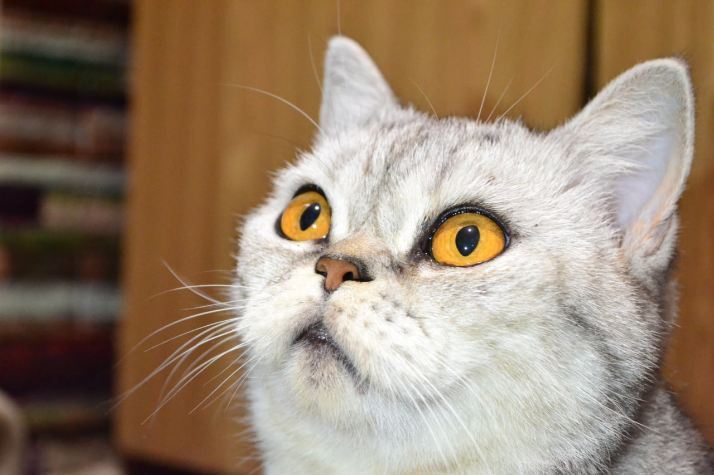
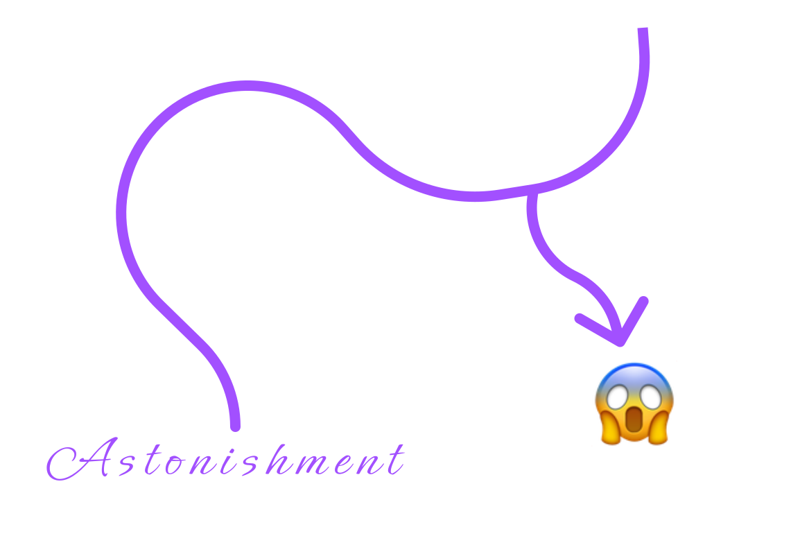
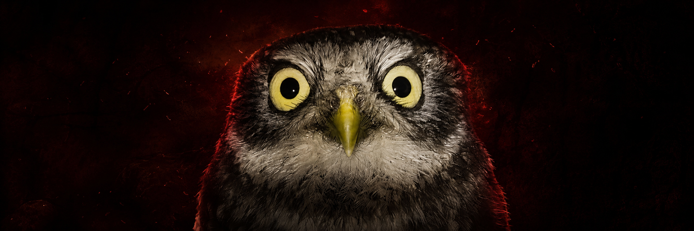

  

 

  
  
Welcome to my GitHub profile.

  

<h3 align="center">🛠️ Languages & Technologies</h3>

  

  

  

<h3 align="center">📊 GitHub Activity</h3>

  <picture>
    <source media="(prefers-color-scheme: dark)" srcset="https://raw.githubusercontent.com/MIXITOSIK/MIXITOSIK/output/github-contribution-grid-snake-dark.svg">
    <source media="(prefers-color-scheme: light)" srcset="https://raw.githubusercontent.com/MIXITOSIK/MIXITOSIK/output/github-contribution-grid-snake.svg">
    
  </picture>

  

